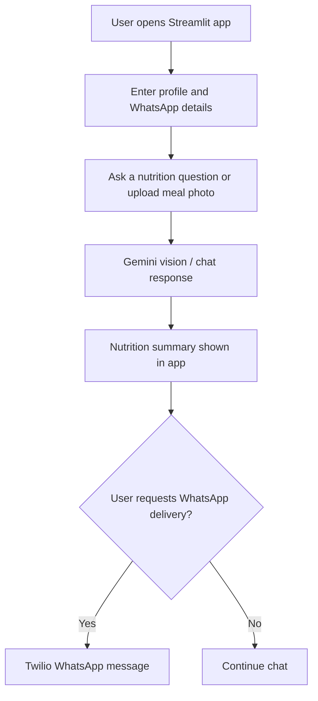

# 🥗 MacroSnap — AI Nutrition Buddy

MacroSnap is an AI nutrition buddy built with **Streamlit**, **Google Gemini (Vision & Chat)**, and **Twilio (WhatsApp)**.

Users enter their name and WhatsApp number once, then chat with MacroSnap by typing a question or uploading a meal photo to get an instant calorie & macro breakdown. With a single click, a complete daily nutrition summary is sent straight to their WhatsApp!

---

## At a glance


**Why it matters:** Meal logging is easier when people can describe a meal naturally or share a photo instead of manually entering every ingredient. MacroSnap explores a chat-first flow that can turn an image or question into an estimated nutrition summary and deliver that summary through WhatsApp.

## User flow



**Important:** Nutrition values generated from a photo or chat are estimates and may be incomplete or inaccurate. They are not medical advice and should not be used as a substitute for professional dietary guidance.

---
## 📁 Project Structure

```
AI_Vision_Chatbot/
├── app.py                     # Streamlit application logic & UI
├── prompts.py                 # System prompt, welcome message, & summary prompts
├── requirements.txt           # Python dependencies (streamlit, google-genai, twilio)
├── .gitignore                 # Excludes secrets and environments from git
├── run.bat / run.ps1          # Easy launch scripts
└── .streamlit/
    ├── secrets.toml.example   # Template for configuration
    └── secrets.toml           # Your real credentials (never committed)
```

---

## 🔑 Setup & API Keys

### 1. Google Gemini API Key
- Go to [Google AI Studio](https://aistudio.google.com/) and click **Get API key**.
- Paste your key in `.streamlit/secrets.toml` under `GEMINI_API_KEY`.

### 2. Twilio Account & WhatsApp Sandbox
1. Sign up for free at [twilio.com/try-twilio](https://www.twilio.com/try-twilio).
2. From the Twilio Console, copy your **Account SID** and **Auth Token**.
3. Go to **Messaging → Try it out → Send a WhatsApp message**:
   - Find the sandbox number and join code (e.g. `join happy-tiger`).
   - Send that join code from your phone's WhatsApp to the sandbox number to opt in.
4. Go to **Messaging → Content Template Builder**:
   - Create a **Text** template:
     ```text
     Hi {{1}}, here's your MacroSnap summary:

     {{2}}
     ```
   - Copy the **Content SID** (starts with `HX...`).
5. Fill these values into `.streamlit/secrets.toml`:
   ```toml
   GEMINI_API_KEY = "your-gemini-api-key"
   TWILIO_ACCOUNT_SID = "your-twilio-account-sid"
   TWILIO_AUTH_TOKEN = "your-twilio-auth-token"
   TWILIO_WHATSAPP_FROM = "whatsapp:+14155238886"
   TWILIO_CONTENT_SID = "HXxxxxxxxxxxxxxxxxxxxxxxxxxxxxxxxx"
   ```

---

## 🚀 Running the App

### Option 1: Using the provided launch scripts
- **Windows Command Prompt / Double-click**: Run `run.bat`
- **PowerShell**: Run `.\run.ps1`

### Option 2: Standard Command Line
```bash
streamlit run app.py
```

The app will open automatically at [http://localhost:8501](http://localhost:8501).

---

## ☁️ Deploying to Streamlit Community Cloud

1. Push this repository to GitHub (ensure `.streamlit/secrets.toml` is **not** committed).
2. Go to [share.streamlit.io](https://share.streamlit.io/) and log in with GitHub.
3. Click **New app**, select your repository, branch, and set `app.py` as the entrypoint.
4. Under **Advanced settings → Secrets**, paste the contents of your `.streamlit/secrets.toml`.
5. Click **Deploy**!

---

## 📄 License

This project is licensed under the [MIT License](LICENSE).
